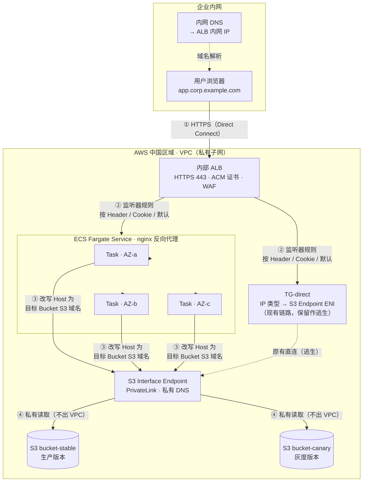
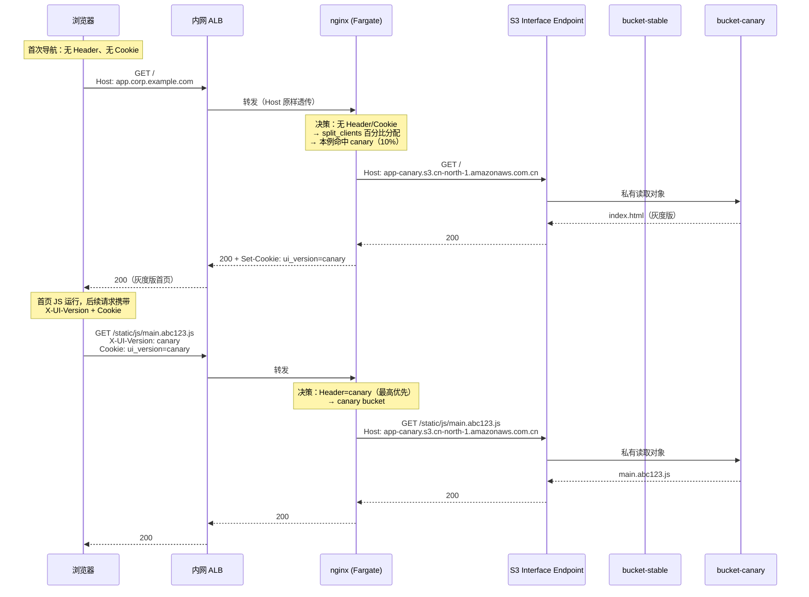
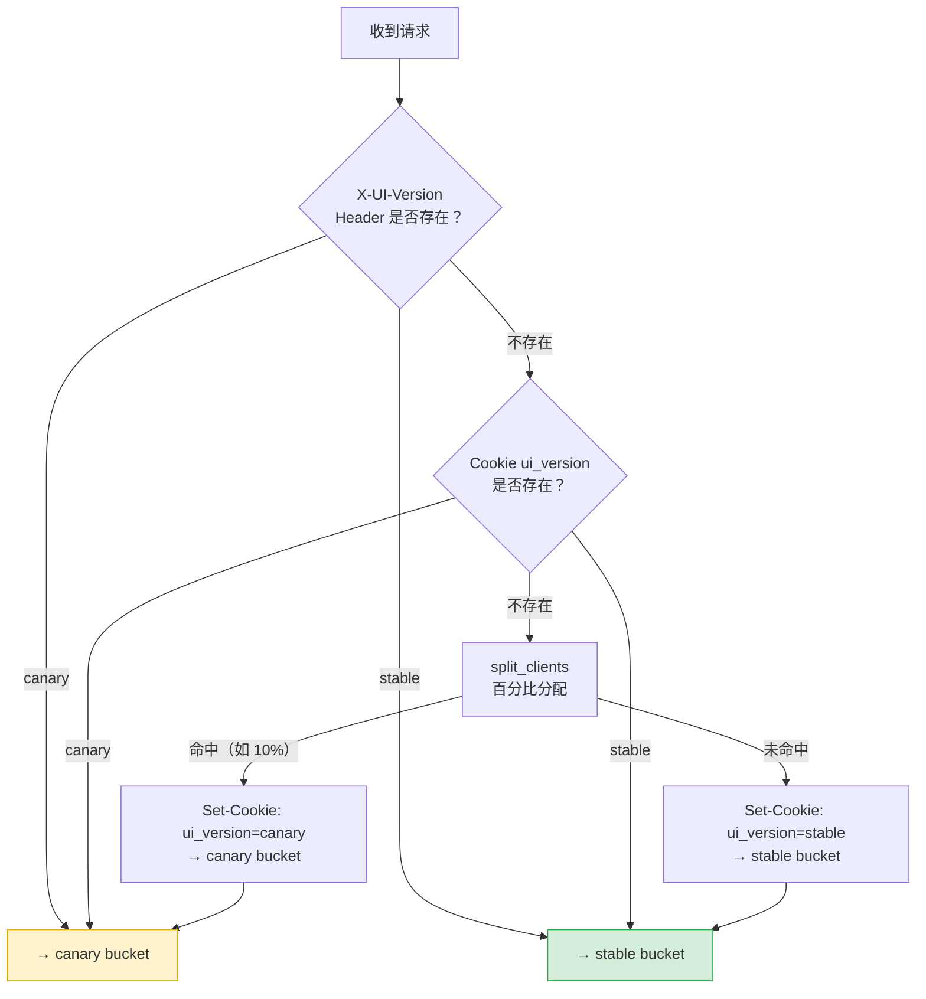
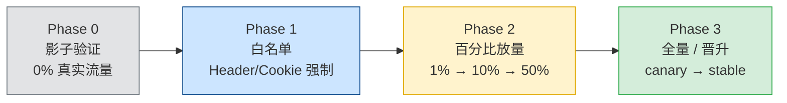
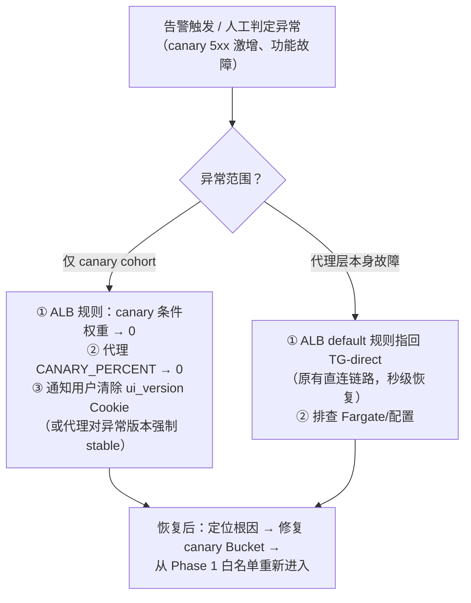

# 内部静态 UI 灰度发布架构设计

| 项目 | 内容 |
|---|---|
| 文档版本 | v1.0 |
| 日期 | 2026-10-12 |
| 状态 | 待评审 |
| 适用范围 | 内网静态 UI（ALB + S3 + PrivateLink 架构）双 Bucket 按 Header/Cookie 灰度发布 |
| 假设 | AWS 中国区域（以北京 `cn-north-1` 为例）；内网域名 `app.corp.example.com`；灰度 Header `X-UI-Version`；两处占位符请按实际替换 |

> 渲染提示：本文档内架构图使用 Mermaid 绘制，请在支持 Mermaid 的 Markdown 阅读器（如 VS Code + 插件、GitLab、Notion、Typora）中查看。

---

## 1. 背景与目标

### 1.1 现状

内部前端应用采用 AWS 官方博客《Hosting Internal HTTPS Static Websites with ALB, S3, and PrivateLink》方案：

- 用户浏览器经 **Direct Connect** 访问内网 ALB（443，ACM 证书）；
- ALB 的 Target Group 为 **IP 类型**，注册的是 **S3 Interface Endpoint（PrivateLink）的 ENI 私有 IP**；
- ALB 原样透传 Host 头，S3 Interface Endpoint 作为 REST API 从 Host 头解析 Bucket 名并返回对象；
- 不同功能模块存放在同一 Bucket 的不同文件夹下。

### 1.2 目标

- 用**两个独立 Bucket**（`bucket-stable` 生产版 / `bucket-canary` 灰度版）承载两套 UI 资源，CI/CD 完全隔离；
- 按请求 **Header**（`X-UI-Version: canary`）实现灰度发布：测试人员可强制进入灰度版，后续支持按比例放量；
- 保持**内网闭环**（不经过公网、不引入 CloudFront 公网边缘），域名、证书、DNS 对用户透明无感知；
- 达到企业级要求：**高可用、可回滚、可观测、安全合规、IaC 可 воспроиз**（可重复）。

### 1.3 关键约束（已确认）

1. 灰度 Header 由**首页加载后**的 JS 定义——首次导航请求不带该 Header（"鸡生蛋"问题，见 §5）；
2. 静态文件**大部分 < 1MB 但不保证**——排除一切有硬性大小限制的方案；
3. ALB 自身**不能改写 Host / Path**（动作仅支持 forward / redirect / fixed-response）。

---

## 2. 现状方案为何做不到（根因）

```
浏览器 --(Host: app.corp.example.com)--> ALB --(Host 原样透传)--> S3 Interface Endpoint
                                                                              |
                                                              从 Host 解析出 Bucket 名
                                                                              v
                                                              必须存在同名 Bucket
```

- ALB 转发时**原样透传 Host**，S3 Interface Endpoint 从 Host 派生 Bucket 名 → **域名与 Bucket 1:1 绑定**；
- ALB 没有改写 Host 的能力 → 无法在 ALB 层把同一域名的流量分发到两个不同名的 Bucket；
- **结论**：必须在 ALB 与 S3 之间插入一层**能改写 Host 的 Origin 选择层**。所有候选方案的本质区别只在于这一层用什么实现。

### 方案比选

| 方案 | 原理 | 结论 |
|---|---|---|
| ALB → **反向代理**（本方案） | 代理读 Header/Cookie，改写 Host 为目标 Bucket 的 S3 域名 | ✅ 无大小限制、语义完整、**推荐** |
| ALB → **Lambda Target** | 函数内读 Header、GetObject、base64 回包 | ❌ ALB→Lambda 响应上限 **1MB 硬限制、不可提额**，超限直接 502，不满足"大小不保证"约束 |
| 纯 ALB 302 跳转双域名 | 命中规则 → 302 到 `app-canary.corp.example.com`（第二个同名 Bucket） | ⚠️ 零新增计算，但地址栏域名变化、SSO Cookie 需跨子域、每个子资源都要带 Header，仅适合手动测试 |
| CloudFront + OAC + Lambda@Edge | 边缘按 Header 换源（公网标准做法） | ❌ 公网边缘服务，内网应用需 WAF 白名单+回源改造，复杂度收益比不划算 |

---

## 3. 总体架构图



**架构要点**：

- 流量入口、TLS、WAF 仍由现有内网 ALB 承担，**域名、证书、DNS 零变更**；
- 新增的唯一组件是无状态的 nginx 代理层（Fargate），只做"读 Header/Cookie → 选 Bucket → 改写 Host → 透传"；
- 双 Bucket 命名从此自由（不再需要等于域名），各自独立 CI 流水线；
- `TG-direct`（现有 IP Target Group）保留，作为紧急逃生通道。

---

## 4. 端到端流量图

### 4.1 首次访问（无 Header、无 Cookie → 百分比分配 + 粘滞）



### 4.2 关键时序说明

| 步骤 | 说明 |
|---|---|
| ① | 浏览器经 Direct Connect 访问内网域名，全程内网，无公网跳转 |
| ② | ALB 按监听器规则分流：显式 Header/Cookie 命中 → 代理；其余按阶段策略（白名单期走直连、放量期加权、终态全走代理） |
| ③ | 代理完成三级决策（Header > Cookie > 百分比），将 Host 改写为目标 Bucket 的 S3 私有域名，经 Interface Endpoint 取对象 |
| ④ | 代理回写 `ui_version` 粘滞 Cookie，后续请求（含子资源）版本一致，杜绝版本混用 |
| ⑤ | 首页 JS 运行后，`X-UI-Version` Header 在后续 fetch/XHR 中作为最高优先级覆盖项 |

---

## 5. 灰度决策逻辑



**设计 rationale**：

- **Header 最高优先**：测试/运维可随时强制指定版本，不受 Cookie 和百分比影响；
- **Cookie 居中**：解决"鸡生蛋"——首屏由百分比分配后立即粘滞，保证同一会话内 index.html 与子资源版本一致；
- **百分比兜底**：仅对"三无"请求（无 Header、无 Cookie 的新访客）生效；基于 `${remote_addr}${http_user_agent}` 哈希，同一 burst 内的并发子资源请求分配结果一致，避免首屏版本混用；
- NAT 出口 IP 粗粒度问题：企业内网多用户共享出口 IP 时，百分比是"按 IP+UA"近似而非精确按人头——Phase 1 白名单阶段不受影响，Phase 2 视观测数据微调。

---

## 6. 详细设计

### 6.1 ALB 与监听器规则

ALB 本体、ACM 证书、安全组沿用现有配置。Target Group 新增 `TG-proxy`（IP 类型，指向 Fargate Task 的 ENI 私有 IP；或使用 ECS Service 的 Target Group 自动注册）。

**监听器规则（HTTPS 443，建议终态）**：

| 优先级 | 条件（AND） | 动作 | 用途 |
|---|---|---|---|
| 10 | `Host = app.corp.example.com` 且 `http-header X-UI-Version = canary` | 转发 → `TG-proxy` | 白名单/强制灰度 |
| 20 | `Host = app.corp.example.com` 且 `http-header Cookie = *ui_version=canary*` | 转发 → `TG-proxy` | Cookie 灰度用户 |
| 30 | `Host = app.corp.example.com` 且 `http-header X-UI-Version = stable` | 转发 → `TG-direct` | 强制回稳定版（逃生语义） |
| default | — | 转发 → `TG-proxy` | 终态：全流量经代理，百分比逻辑在代理内 |

> 说明：ALB 的 `http-header` 条件支持 `*` `?` 通配符且不区分大小写，因此 `Cookie = *ui_version=canary*` 可匹配混杂多 Cookie 的请求头。迁移过渡期 default 可设为**加权转发**（`TG-direct` 90 + `TG-proxy` 10），逐步放量后再切为全代理。

**健康检查**：`TG-proxy` 健康检查 `HTTP:8080/healthz`，期望 200，间隔 30s，健康阈值 2，不健康阈值 3，deregistration delay 30s。

### 6.2 反向代理层（ECS Fargate + nginx）

**ECS Service**：

- 启动类型 Fargate，跨 3 AZ 私有子网，期望任务数 ≥ 2；
- Target Tracking 自动扩缩：`ALBRequestCountPerTarget`（如 >1000 req/min/target 扩容）+ CPU > 70%；
- 部署：滚动更新（`minimumHealthyPercent=100`，`maximumPercent=200`），配合 ALB deregistration 做到零中断；
- 任务角色（Task Role）：仅需 `s3:GetObject`（经 Interface Endpoint 访问双 Bucket）+ CloudWatch Logs 写权限；**不需要**公网 egress（镜像来自 ECR 私有仓库或经 ECR Interface Endpoint 拉取）。

**nginx 完整配置**（`X-UI-Version` / `ui_version` / 百分比三级决策，生产级示意）：

```nginx
# /etc/nginx/nginx.conf
user nginx;
worker_processes auto;
error_log /var/log/nginx/error.log warn;
pid /var/run/nginx.pid;

events {
    worker_connections 2048;
}

http {
    include       /etc/nginx/mime.types;
    default_type  application/octet-stream;

    # JSON 访问日志：cohort / 上游 bucket / 耗时全部打点，供灰度看板使用
    log_format json_combined escape=json
        '{"time":"$time_iso8601","request_id":"$request_id",'
        '"remote_addr":"$remote_addr","method":"$request_method",'
        '"uri":"$request_uri","status":$status,"bytes":$body_bytes_sent,'
        '"cohort":"$cohort","upstream":"$s3_host",'
        '"rt":$request_time,"urt":"$upstream_response_time",'
        '"ua":"$http_user_agent"}';
    access_log /var/log/nginx/access.log json_combined;

    # ---------- 灰度决策输入 ----------
    map $http_x_ui_version $c_h { default ""; "canary" "canary"; "stable" "stable"; }
    map $cookie_ui_version  $c_c { default ""; "canary" "canary"; "stable" "stable"; }
    # 百分比：CI/CD 通过构建参数替换 CANARY_PERCENT 后生成本文件
    split_clients "${remote_addr}${http_user_agent}" $c_p { 10% "canary"; * "stable"; }

    # S3 私有域名解析（VPC DNS；S3 域名 TTL 短）
    resolver 169.254.169.253 valid=10s ipv6=off;
    resolver_timeout 5s;

    proxy_connect_timeout 5s;
    proxy_read_timeout    30s;
    proxy_next_upstream   error timeout http_500 http_502 http_503;

    server {
        listen 8080;
        server_name _;

        # ---------- 三级决策：Header > Cookie > 百分比 ----------
        set $cohort $c_p;
        if ($c_c != "") { set $cohort $c_c; }
        if ($c_h != "") { set $cohort $c_h; }

        set $s3_host "app-stable.s3.cn-north-1.amazonaws.com.cn";
        if ($cohort = "canary") {
            set $s3_host "app-canary.s3.cn-north-1.amazonaws.com.cn";
        }

        # 粘滞 Cookie（Secure/HttpOnly/SameSite；如需跨子域再加 Domain）
        add_header Set-Cookie "ui_version=$cohort; Path=/; Secure; HttpOnly; SameSite=Lax" always;

        # 统一安全头（CSP 按应用实际需求调整后启用）
        add_header Strict-Transport-Security "max-age=31536000; includeSubDomains" always;
        add_header X-Content-Type-Options "nosniff" always;
        add_header X-Frame-Options "SAMEORIGIN" always;

        location = /healthz {
            access_log off;
            add_header Content-Type text/plain;
            return 200 'ok';
        }

        location / {
            proxy_pass https://$s3_host;
            proxy_set_header Host $s3_host;      # 核心：Host 改写为目标 Bucket 的 S3 域名
            proxy_ssl_server_name on;            # SNI
            proxy_ssl_name $s3_host;
            proxy_ssl_protocols TLSv1.2 TLSv1.3;
            proxy_http_version 1.1;
            proxy_set_header Connection "";

            # SPA 深链接 fallback：目录/未知路径 403/404 → index.html（按需启用）
            proxy_intercept_errors on;
            error_page 403 404 =200 /index.html;
        }

        location = /index.html {
            internal;
            proxy_pass https://$s3_host/index.html;
            proxy_set_header Host $s3_host;
            proxy_ssl_server_name on;
            proxy_ssl_name $s3_host;
            proxy_http_version 1.1;
            proxy_set_header Connection "";
        }
    }
}
```

> 实施提示：
> - `CANARY_PERCENT` 做成镜像构建/Task 启动时的模板变量，由发布流水线参数驱动（1% → 10% → 50% → 100%）；
> - 如需**按功能文件夹灰度**（现状是不同功能在不同文件夹），加 `location /feature-a/ { ... }` 覆盖 `$s3_host` 即可，代理层天然支持；
> - 代理到 S3 需信任 Amazon Root CA（Amazon Linux / 官方 nginx 镜像默认已包含）。

### 6.3 S3 双 Bucket

| 项 | `bucket-stable` | `bucket-canary` |
|---|---|---|
| 用途 | 生产版本 | 灰度版本 |
| 命名 | 自由（**不再需要等于域名**） | 自由 |
| 版本控制 | 建议开启（内容级回滚） | 建议开启 |
| Block Public Access | 全部开启 | 全部开启 |
| 访问日志 | S3 Server Access Logging → 日志 Bucket | 同左 |
| Bucket Policy | 仅允许经指定 Interface Endpoint `GetObject`（下） | 同左 |

**Bucket Policy（`aws-cn` 分区，`vpce-xxx` 替换为实际 S3 Interface Endpoint ID）**：

```json
{
  "Version": "2012-10-17",
  "Statement": [
    {
      "Sid": "AllowGetObjectViaVPCEOnly",
      "Effect": "Allow",
      "Principal": "*",
      "Action": "s3:GetObject",
      "Resource": [
        "arn:aws-cn:s3:::app-canary",
        "arn:aws-cn:s3:::app-canary/*"
      ],
      "Condition": {
        "StringEquals": { "aws:SourceVpce": "vpce-xxxxxxxxxxxxxxxxx" }
      }
    }
  ]
}
```

> 部署注意：S3 自 2020 年起为强一致性，`index.html` 与带 hash 资源文件同批上传即同时可见，无需"失效"操作；但为保险起见，CI 应保证**先传资源文件、最后传 `index.html`**（或用版本化目录）。

### 6.4 网络与 DNS

- **S3 Interface Endpoint**：沿用现有（或为新 VPC 新建），**开启私有 DNS**，代理直接使用标准 S3 域名（`*.s3.cn-north-1.amazonaws.com.cn`）即在 VPC 内私有解析；
- **DNS**：内网 DNS（Route 53 Private Hosted Zone 或本地 DNS 转发）`app.corp.example.com` → 内网 ALB，**零变更**；
- **安全组**：
  - ALB SG：入站仅 443，源 = Direct Connect/专线网段；
  - Fargate SG：入站仅 8080，源 = ALB SG；
  - VPCE SG：入站 443，源 = Fargate SG（+ 保留 ALB SG 以兼容现有直连链路）；
- **出站**：代理 Task 无需公网 egress；ECR 镜像拉取经 ECR Interface Endpoint 或 VPC 内 ECR 私有仓库。

### 6.5 TLS

- 浏览器 → ALB：现有 ACM 证书**不变**，TLS 1.2+；
- 代理 → S3：HTTPS + SNI（`proxy_ssl_server_name on`），S3 返回 `*.s3.cn-north-1.amazonaws.com.cn` 证书，代理校验证书链；
- ALB → 代理：VPC 内明文 8080（安全组隔离）或按需配置自签/mTLS；企业内网常规做法为 VPC 内明文 + SG 强隔离。

### 6.6 安全加固清单

- [ ] 双 Bucket：Block Public Access 全开 + `aws:SourceVpce` 策略 + 访问日志
- [ ] ALB 挂载 AWS WAF（AWSManagedRulesCommonRuleSet + 限流规则），内网亦防误伤/防爬
- [ ] 代理注入安全头：HSTS / nosniff / SAMEORIGIN（CSP 按应用联调后启用）
- [ ] Fargate Task Role 最小权限（仅双 Bucket `GetObject` + 日志）
- [ ] 容器镜像签名/扫描（ECR image scanning），基础镜像定期更新
- [ ] ALB 访问日志 → S3（审计灰度流量比例）

---

## 7. 发布与回滚方案

### 7.1 灰度放量阶段



| 阶段 | 流量 | 准入条件 | 准出条件（进入下一阶段） | 回滚动作 |
|---|---|---|---|---|
| Phase 0 影子验证 | 0% 真实用户 | 代理层上线；ALB 白名单规则就绪 | 内部 curl/自动化冒烟通过；双 Bucket 内容一致性校验通过 | 下线白名单规则 |
| Phase 1 白名单 | 仅测试人员（Header/Cookie 强制） | 测试团队就绪 | 功能验收通过；连续 2 天 canary 5xx < 0.1% | 移除测试人员 Cookie/Header |
| Phase 2 百分比放量 | 1% → 10% → 50% 真实流量 | Phase 1 准出 | 每个梯度观察 ≥ 24h（或 ≥ 1 个业务高峰）；canary vs stable 错误率/延迟无显著劣化 | 百分比调回上一梯度或直接 0 |
| Phase 3 全量/晋升 | 100% → canary 晋升为 stable | Phase 2 准出 | 全量稳定运行 1 周 | 将 stable Bucket 内容回滚到上一版本（S3 版本控制） |

> 每个梯度必须有**明确的负责人签字**方可进入下一阶段；回滚操作均为"改一处配置"级别（ALB 规则权重 / `CANARY_PERCENT` / Cookie），**1 分钟内生效**。

### 7.2 回滚流程



**回滚时间目标**：RTO ≤ 5 分钟（纯配置变更，无需重新部署）。

---

## 8. 可观测性

| 层级 | 采集 | 关键指标 / 用途 |
|---|---|---|
| ALB | Access Log → S3（Athena 查询） | 按 Target Group 分的请求量、5xx、延迟；验证灰度流量占比是否符合预期 |
| nginx | JSON access log → CloudWatch Logs | `cohort`、`upstream`（实际命中的 Bucket）、`rt`/`urt`；按 cohort 对比错误率与延迟 |
| nginx | CloudWatch 自定义指标 / Prometheus（如有） | canary 占比、按 Bucket 分的 5xx 率、P50/P99 |
| ECS | Container Insights | CPU/内存、任务数、部署事件 |
| S3 | Server Access Logging + CloudWatch 请求指标 | 双 Bucket 的 GetObject 量、4xx（缺失资源早发现） |

**告警（建议阈值，按实际调优）**：

- `canary 5xx 率 > 1% 持续 5 分钟` → P1 告警，触发回滚 runbook；
- `canary P99 延迟 > stable P99 × 2 持续 10 分钟` → P2 告警；
- `TG-proxy 不健康主机数 > 0` → P1 告警；
- `ALB 目标 5xx 总量突增` → P1 告警。

**看板**：单屏展示"canary 流量占比 / 双 cohort 错误率对比 / 双 cohort 延迟对比 / 当前 `CANARY_PERCENT` / 最近发布事件"。

---

## 9. 实施计划

| 阶段 | 周期（参考） | 主要任务 | 验收标准 |
|---|---|---|---|
| **Phase 0 准备** | 1 周 | ① IaC 仓库初始化（Terraform/CDK：ALB 规则、双 Bucket+策略、ECS、Endpoint 引用）；② 确认 Region/域名/证书/Header 名/Cookie 名；③ 双 Bucket 创建+策略+Block Public Access；④ CI 规范：资源先传、`index.html` 后传；⑤ 采集 1 周基线指标（QPS、P99、5xx） | 基线看板就绪；`aws s3 cp` 经 VPCE 读写验证通过 |
| **Phase 1 代理上线** | 1 周 | ① nginx 镜像构建→ECR（含扫描）；② Fargate Service 上线（3 AZ、私有子网、自动扩缩）；③ `TG-proxy` + 健康检查；④ ALB 白名单规则（优先级 10/20/30）；⑤ 内网冒烟：curl 带 Header/Cookie 验证双 Bucket 命中正确 | 带 `X-UI-Version: canary` 返回 canary 内容；不带返回 stable；日志中 `cohort` 字段正确 |
| **Phase 2 白名单灰度** | 1–2 周 | 测试团队通过 Header/插件/Cookie 进入 canary；功能验收；安全头、CSP 联调 | 测试报告通过；canary 5xx < 0.1% 连续 2 天 |
| **Phase 3 百分比放量** | 2–4 周 | `CANARY_PERCENT`：1% → 10% → 50%（每梯度 ≥ 24h / 1 个业务高峰）；看板值守 | 各梯度指标门禁通过；负责人签字放行 |
| **Phase 4 收尾** | 1 周 | ① 100% 后观察 1 周；② canary 内容晋升为 stable（或切换 CI 主分支）；③ ALB default 切全代理；④ `TG-direct` 保留为逃生（文档化）；⑤ 复盘归档 | 全量稳定；回滚演练通过；文档归档 |

**人力参考**：网络/平台工程师 1 名（ALB/VPC/ECS/IaC）+ 前端或发布工程师 1 名（Bucket 内容流水线、验收），各阶段兼职投入即可。

---

## 10. 成本估算（中国区域，约数）

| 项 | 规格 | 月费用估算 |
|---|---|---|
| Fargate | 2 × 0.25 vCPU / 0.5 GB（按需） | ≈ ¥120–180 |
| ALB | 现有复用，仅增 LCU 少量 | 增量可忽略 |
| S3 Interface Endpoint | 已有复用 | 0（已有） |
| S3 请求/存储 | 静态资源，量小 | < ¥50 |
| CloudWatch Logs | JSON 访问日志（按量） | < ¥50 |
| **合计** | | **≈ ¥200–300 / 月** |

> 按 Fargate Spot 可再降 ~60%；费用量级相对现有 ALB/Endpoint 可忽略。

---

## 11. 风险与应对

| 风险 | 影响 | 应对 |
|---|---|---|
| 企业 NAT 出口 IP 粗粒度导致百分比不精确 | 放量比例与预期偏差 | Phase 1 白名单不受影响；Phase 2 以看板实际占比为准动态调整 `CANARY_PERCENT` |
| 用户清除 Cookie 后被重新分配 | 个别用户版本跳变 | 可接受（灰度场景）；如需强一致，改由服务端按工号/设备 ID 哈希（需应用配合传标识） |
| `index.html` 与资源文件上传不同步 | 短暂 404/版本混用 | CI 强制"资源先传、index.html 后传"；S3 强一致性兜底 |
| Interface Endpoint ENI IP 变更 | 仅影响旧 `TG-direct`（注册的是 IP） | 代理层使用 DNS，无此问题；旧链路保留监控，IP 变更时重新注册 |
| 大文件（>1MB） | 无影响 | 本方案无 payload 上限；Lambda 方案已因该风险被排除 |
| 代理层单点配置错误 | 全站异常 | ALB 健康检查自动摘除异常 Task；极端情况秒切回 `TG-direct` |

---

## 12. 附录

### 12.1 Terraform 关键片段（示意）

```hcl
# 白名单规则：Header 命中 -> TG-proxy
resource "aws_lb_listener_rule" "canary_header" {
  listener_arn = aws_lb_listener.https.arn
  priority     = 10
  action {
    type             = "forward"
    target_group_arn = aws_lb_target_group.tg_proxy.arn
  }
  condition {
    host_header { values = ["app.corp.example.com"] }
  }
  condition {
    http_header {
      http_header_name = "X-UI-Version"
      values           = ["canary"]
    }
  }
}

# Cookie 规则：通配符匹配
resource "aws_lb_listener_rule" "canary_cookie" {
  listener_arn = aws_lb_listener.https.arn
  priority     = 20
  action {
    type             = "forward"
    target_group_arn = aws_lb_target_group.tg_proxy.arn
  }
  condition {
    host_header { values = ["app.corp.example.com"] }
  }
  condition {
    http_header {
      http_header_name = "Cookie"
      values           = ["*ui_version=canary*"]
    }
  }
}
```

### 12.2 决策记录（ADR 摘要）

| 决策 | 选择 | 原因 |
|---|---|---|
| Origin 选择层 | ECS Fargate + nginx（而非 Lambda） | Lambda 经 ALB 响应上限 1MB 硬限制且不可提额；静态文件大小不保证 <1MB，企业级不接受随机 502 |
| 灰度载体 | Header（强制）+ Cookie（粘滞）+ 百分比（兜底） | Header 由首页 JS 定义，首次导航缺失——三级决策解决"鸡生蛋"，同时保留 Header 作为最高优先级开关 |
| 边缘方案 | 不用 CloudFront | 内网闭环要求；公网边缘+WAF 白名单复杂度收益比不划算 |
| 终态流量 | 全量经代理（而非长期加权） | 统一 SPA fallback、安全头、日志口径；旧直连链路保留作秒级逃生 |

### 12.3 待确认事项（评审会前）

- [ ] 目标 Region（北京 `cn-north-1` / 宁夏 `cn-northwest-1`）
- [ ] 双 Bucket 正式命名与 CI 产物推送规范
- [ ] Header 名 `X-UI-Version` 与取值（`canary`/`stable`）最终确认
- [ ] 各放量梯度的负责人与签字机制
- [ ] 是否需要按功能文件夹独立灰度（代理层已预留 `location` 扩展点）
- [ ] CSP 策略内容（安全头联调）
